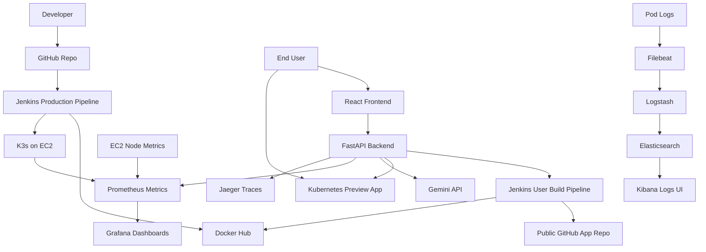

# Complete EC2 Deployment Guide: Repo2Docker, Kubernetes, Monitoring, Logging, and Tracing

This guide deploys the full Repo2Docker platform on one AWS EC2 instance:

- React frontend
- FastAPI backend
- Jenkins
- Docker
- K3s Kubernetes
- Helm
- Horizontal Pod Autoscaling
- Prometheus and Grafana monitoring
- ELK logging: Elasticsearch, Logstash, Kibana, Filebeat
- Jaeger distributed tracing
- Kubernetes preview apps for successful user builds

## 0. What You Will Build



## 1. Cost-Conscious Architecture

Use one EC2 instance instead of EKS.

Recommended demo instance:

```text
t3.medium or t3.large for full ELK + monitoring demo
30-50 GB gp3 disk
Elastic IP only if you need stable access
```

Minimum possible:

```text
t3.micro/t3.small for app + Jenkins + K3s only
```

ELK is memory-heavy. If you run Prometheus, Grafana, ELK, Jaeger, Jenkins, and preview apps together, `t3.micro` may not be enough. For a college demo, start ELK only when showing logging.

## 2. Local Preparation

From your local machine:

```bash
git status
python3 -m compileall backend/app
cd frontend
npm install
npm run build
cd ..
helm template repo2docker charts/repo2docker
terraform fmt -recursive terraform
```

Expected:

- Python compile passes.
- Frontend build passes.
- Helm template renders.
- Terraform formatting finishes.

## 3. AWS Prerequisites

You need:

- AWS account
- AWS CLI configured
- Terraform installed
- Existing EC2 key pair
- Docker Hub account
- Gemini API key
- GitHub repository containing this project

Check AWS identity:

```bash
aws sts get-caller-identity
```

Find your public IP:

```bash
curl https://checkip.amazonaws.com
```

Use that IP as:

```text
YOUR_PUBLIC_IP/32
```

## 4. Provision EC2 With Terraform

From project root:

```bash
cd terraform/aws-low-cost
cp terraform.tfvars.example terraform.tfvars
```

Edit `terraform.tfvars`:

```hcl
key_name              = "your-existing-ec2-keypair"
allowed_ssh_cidr      = "YOUR_PUBLIC_IP/32"
allowed_jenkins_cidr  = "YOUR_PUBLIC_IP/32"
create_elastic_ip     = false
instance_type         = "t3.medium"
root_volume_size      = 50
```

Apply:

```bash
terraform init
terraform plan
terraform apply
```

Save outputs:

```bash
terraform output
```

You need:

```text
public_ip
jenkins_url
repo2docker_url
```

SSH into EC2:

```bash
ssh ubuntu@EC2_PUBLIC_IP
```

## 5. Verify EC2 Bootstrap

On EC2:

```bash
docker --version
kubectl get nodes
helm version
sudo systemctl status jenkins --no-pager
```

Get Jenkins initial password:

```bash
sudo cat /var/lib/jenkins/secrets/initialAdminPassword
```

Open Jenkins:

```text
http://EC2_PUBLIC_IP:8080
```

Install suggested plugins:

- Pipeline
- Git
- GitHub
- Docker Pipeline
- Credentials Binding

## 6. Clone Repo on EC2

On EC2:

```bash
git clone YOUR_REPO_URL Repo2Docker
cd Repo2Docker
```

Log in to Docker Hub:

```bash
docker login
```

## 7. Configure Local Hostnames

For easiest browser testing from your laptop, add these to your laptop `/etc/hosts` file:

```text
EC2_PUBLIC_IP repo2docker.local grafana.repo2docker.local kibana.repo2docker.local jaeger.repo2docker.local
```

If you do not want hostnames, use port-forwarding instead.

## 8. Build and Push Repo2Docker Images

On EC2:

```bash
docker build -t YOUR_DOCKERHUB_USERNAME/repo2docker-backend:latest backend
docker build -t YOUR_DOCKERHUB_USERNAME/repo2docker-frontend:latest frontend

docker push YOUR_DOCKERHUB_USERNAME/repo2docker-backend:latest
docker push YOUR_DOCKERHUB_USERNAME/repo2docker-frontend:latest
```

## 9. Install Prometheus and Grafana

```bash
helm repo add prometheus-community https://prometheus-community.github.io/helm-charts
helm repo update

helm upgrade --install kube-prometheus-stack prometheus-community/kube-prometheus-stack \
  --namespace monitoring \
  --create-namespace \
  -f monitoring/kube-prometheus-stack-values.yaml

kubectl apply -f monitoring/repo2docker-alerts.yaml
kubectl apply -f monitoring/repo2docker-dashboard-configmap.yaml
```

Check:

```bash
kubectl get pods -n monitoring
```

Open Grafana by hostname:

```text
http://grafana.repo2docker.local
```

Or port-forward:

```bash
kubectl port-forward -n monitoring service/kube-prometheus-stack-grafana 3000:80
```

Then open:

```text
http://localhost:3000
```

## 10. Install Jaeger Tracing

```bash
kubectl create namespace observability --dry-run=client -o yaml | kubectl apply -f -
kubectl apply -f observability/tracing/jaeger-all-in-one.yaml
```

Check:

```bash
kubectl get pods -n observability
kubectl get svc -n observability
```

Open Jaeger:

```text
http://jaeger.repo2docker.local
```

Or port-forward:

```bash
kubectl port-forward -n observability service/jaeger-query 16686:16686
```

Then open:

```text
http://localhost:16686
```

## 11. Install ELK Logging

Add Elastic Helm repo:

```bash
helm repo add elastic https://helm.elastic.co
helm repo update
```

Install Elasticsearch:

```bash
helm upgrade --install elasticsearch elastic/elasticsearch \
  --namespace observability \
  -f observability/logging/elasticsearch-values.yaml
```

Install Logstash:

```bash
helm upgrade --install logstash elastic/logstash \
  --namespace observability \
  -f observability/logging/logstash-values.yaml
```

Install Kibana:

```bash
helm upgrade --install kibana elastic/kibana \
  --namespace observability \
  -f observability/logging/kibana-values.yaml
```

Install Filebeat:

```bash
helm upgrade --install filebeat elastic/filebeat \
  --namespace observability \
  -f observability/logging/filebeat-values.yaml
```

Check:

```bash
kubectl get pods -n observability
```

Open Kibana:

```text
http://kibana.repo2docker.local
```

Or port-forward:

```bash
kubectl port-forward -n observability service/kibana-kibana 5601:5601
```

Then open:

```text
http://localhost:5601
```

Create Kibana data view:

```text
repo2docker-logs-*
```

## 12. Deploy Repo2Docker With Helm

Install the app with monitoring and tracing enabled:

```bash
helm upgrade --install repo2docker charts/repo2docker \
  --namespace repo2docker \
  --create-namespace \
  --set images.backend.repository=YOUR_DOCKERHUB_USERNAME/repo2docker-backend \
  --set images.frontend.repository=YOUR_DOCKERHUB_USERNAME/repo2docker-frontend \
  --set backend.env.dockerhubUsername=YOUR_DOCKERHUB_USERNAME \
  --set backend.env.jenkinsUrl=http://EC2_PUBLIC_IP:8080 \
  --set backend.env.previewDeployEnabled=true \
  --set backend.env.previewBaseUrl=http://repo2docker.local \
  --set backend.env.otelTracingEnabled=true \
  --set backend.env.otelExporterOtlpEndpoint=http://jaeger-collector.observability.svc.cluster.local:4317 \
  --set backend.secrets.jenkinsUsername=YOUR_JENKINS_USERNAME \
  --set backend.secrets.jenkinsApiToken=YOUR_JENKINS_API_TOKEN \
  --set backend.secrets.geminiApiKey=YOUR_GEMINI_API_KEY
```

After Prometheus is ready, enable ServiceMonitor:

```bash
helm upgrade --install repo2docker charts/repo2docker \
  --namespace repo2docker \
  --reuse-values \
  --set monitoring.serviceMonitor.enabled=true
```

Check rollout:

```bash
kubectl rollout status deployment/repo2docker-backend -n repo2docker
kubectl rollout status deployment/repo2docker-frontend -n repo2docker
kubectl get pods -n repo2docker
kubectl get hpa -n repo2docker
kubectl get ingress -n repo2docker
```

Open app:

```text
http://repo2docker.local
```

## 13. Configure Jenkins User Build Pipeline

In Jenkins, create credentials:

```text
dockerhub-credentials
```

Kind:

```text
Username with password
```

Create pipeline job:

```text
repo2docker
```

Use pipeline script from:

```text
jenkins/Jenkinsfile
```

This is the user build pipeline triggered by FastAPI.

## 14. Configure Jenkins Production Pipeline

Create these credentials:

```text
dockerhub-credentials
dockerhub-username
jenkins-username
jenkins-api-token
gemini-api-key
```

Create production pipeline using:

```text
jenkins/Jenkinsfile.production
```

Configure GitHub webhook:

```text
http://EC2_PUBLIC_IP:8080/github-webhook/
```

Production pipeline gates:

- Backend compile check
- Frontend build check
- Docker image build
- Optional Trivy scan
- Docker push
- Helm deploy
- Kubernetes rollout check
- Smoke test

## 15. Full End-to-End Functional Test

Open:

```text
http://repo2docker.local
```

Submit a public GitHub repository that has a root `Dockerfile`.

Example values:

```text
GitHub Repository URL: https://github.com/YOUR_USER/YOUR_TEST_APP
Docker Image Name: repo2docker-test
Application Port: 3000
```

Expected successful flow:

```text
React UI
  -> FastAPI
  -> Jenkins
  -> GitHub clone
  -> Docker build
  -> Docker Hub push
  -> Kubernetes preview deployment
  -> Open App button
```

Check build status:

```bash
kubectl logs -n repo2docker deployment/repo2docker-backend
kubectl get namespaces | grep repo2docker-preview
kubectl get all -n repo2docker-preview-1
kubectl get ingress -n repo2docker-preview-1
```

Click:

```text
Open App
```

Expected:

- User application opens in browser.
- Raw Jenkins logs are visible in Repo2Docker.
- Docker pull/run commands are visible.

## 16. Validate Prometheus Metrics

Open Prometheus:

```bash
kubectl port-forward -n monitoring service/kube-prometheus-stack-prometheus 9090:9090
```

Open:

```text
http://localhost:9090
```

Run queries:

```promql
repo2docker_build_requests_total
repo2docker_build_success_total
repo2docker_build_failure_total
repo2docker_active_builds
repo2docker_running_preview_apps
histogram_quantile(0.95, sum(rate(repo2docker_api_request_duration_seconds_bucket[5m])) by (le))
```

Grafana should show:

- Build requests
- Success/failure counts
- Active builds
- API latency
- EC2 CPU
- EC2 memory
- EC2 disk
- Kubernetes running pods

## 17. Validate ELK Logs

Open Kibana:

```text
http://kibana.repo2docker.local
```

Go to:

```text
Discover
```

Select data view:

```text
repo2docker-logs-*
```

Search examples:

```text
kubernetes.namespace : "repo2docker"
```

```text
kubernetes.container.name : "backend"
```

```text
message : "Jenkins"
```

Expected:

- Backend logs appear.
- Frontend container logs appear.
- Preview app pod logs appear.
- Jenkins-related backend logs can be searched.

## 18. Validate Jaeger Traces

Open Jaeger:

```text
http://jaeger.repo2docker.local
```

Select service:

```text
repo2docker-backend
```

Trigger API traffic:

```bash
curl http://repo2docker.local/health
curl http://repo2docker.local/metrics
```

Submit a build from the UI.

Expected:

- FastAPI request traces appear.
- You can inspect request duration and route spans.

## 19. Validate HPA

Check HPA:

```bash
kubectl get hpa -n repo2docker
kubectl top pods -n repo2docker
kubectl top nodes
```

Generate simple load against backend:

```bash
kubectl run load-test --rm -i --restart=Never --image=busybox:1.36 -- /bin/sh -c \
  'while true; do wget -q -O- http://repo2docker-backend.repo2docker.svc.cluster.local:8000/health >/dev/null; done'
```

Watch:

```bash
kubectl get hpa -n repo2docker -w
```

Note: on one EC2 instance, HPA scales pods only within the same machine. It does not add new EC2 instances.

## 20. Cleanup Preview Apps

Preview namespaces consume resources:

```bash
MAX_AGE_HOURS=2 ./scripts/cleanup-preview-namespaces.sh
```

Add cron:

```bash
crontab -e
```

Example:

```text
0 * * * * cd /home/ubuntu/Repo2Docker && MAX_AGE_HOURS=2 ./scripts/cleanup-preview-namespaces.sh >> /tmp/repo2docker-cleanup.log 2>&1
```

## 21. Stop Heavy Observability When Not Needed

To save memory, uninstall ELK after demo:

```bash
helm uninstall filebeat -n observability
helm uninstall kibana -n observability
helm uninstall logstash -n observability
helm uninstall elasticsearch -n observability
```

Uninstall Jaeger:

```bash
kubectl delete -f observability/tracing/jaeger-all-in-one.yaml
```

Uninstall Prometheus/Grafana:

```bash
helm uninstall kube-prometheus-stack -n monitoring
```

## 22. Destroy AWS Resources

From local machine:

```bash
cd terraform/aws-low-cost
terraform destroy
```

Do this after demos to avoid AWS charges.

## 23. Troubleshooting

### Pods Pending

```bash
kubectl describe pod POD_NAME -n NAMESPACE
kubectl get events -A --sort-by=.lastTimestamp
```

Most common cause: not enough CPU/memory on EC2.

### Elasticsearch CrashLoopBackOff

Check memory:

```bash
kubectl top nodes
kubectl logs -n observability statefulset/elasticsearch-master
```

Use bigger EC2 instance or stop other workloads.

### No Logs in Kibana

Check:

```bash
kubectl logs -n observability daemonset/filebeat-filebeat
kubectl logs -n observability statefulset/logstash-logstash
kubectl get indices
```

Port-forward Elasticsearch and check indices:

```bash
kubectl port-forward -n observability service/elasticsearch-master 9200:9200
curl http://localhost:9200/_cat/indices?v
```

### No Traces in Jaeger

Check backend environment:

```bash
kubectl exec -n repo2docker deployment/repo2docker-backend -- env | grep OTEL
```

Check Jaeger collector:

```bash
kubectl get svc -n observability jaeger-collector
kubectl logs -n observability deployment/jaeger
```

### Jenkins Cannot Push Docker Image

Check:

- `dockerhub-credentials` exists.
- Docker Hub token is valid.
- Image name is lowercase.
- Jenkins user can run Docker.

### Backend Cannot Create Preview Apps

```bash
kubectl auth can-i create deployments --as=system:serviceaccount:repo2docker:repo2docker-backend -A
kubectl auth can-i create ingresses --as=system:serviceaccount:repo2docker:repo2docker-backend -A
kubectl auth can-i create horizontalpodautoscalers --as=system:serviceaccount:repo2docker:repo2docker-backend -A
```

## 24. Final Validation Checklist

- React UI opens.
- FastAPI `/health` returns OK.
- FastAPI `/metrics` exposes Prometheus metrics.
- Jenkins user build pipeline runs.
- Docker image is pushed to Docker Hub.
- Kubernetes preview namespace is created.
- `Open App` button opens preview app.
- Grafana dashboard shows metrics.
- Prometheus targets are healthy.
- Kibana shows backend/frontend/preview logs.
- Jaeger shows `repo2docker-backend` traces.
- HPA exists for frontend/backend and preview apps.
- Production Jenkins pipeline deploys Repo2Docker after GitHub push.
